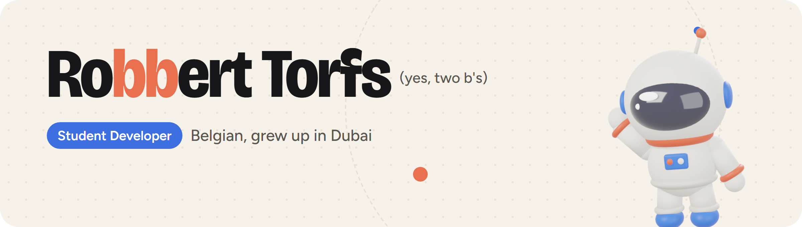
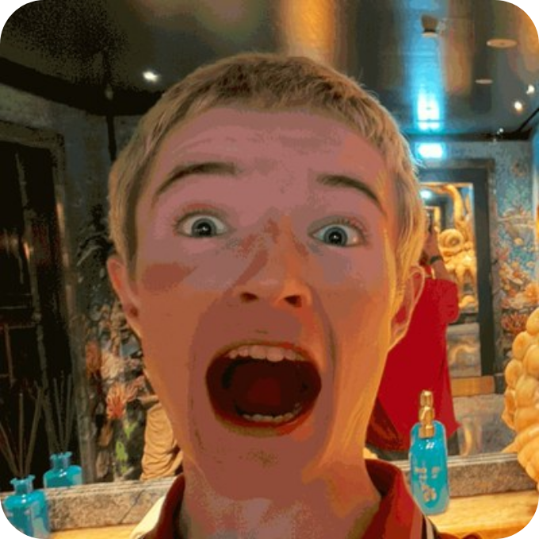
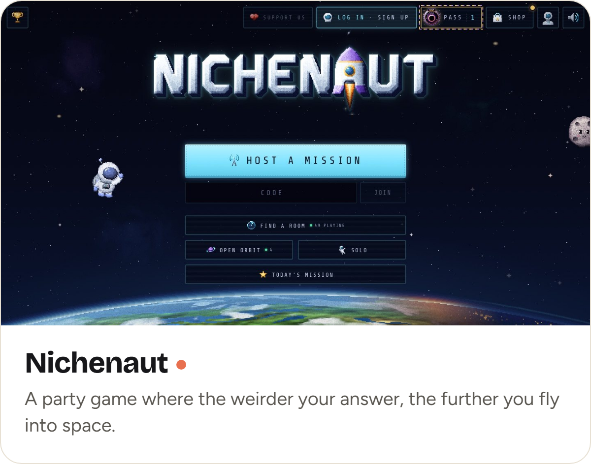
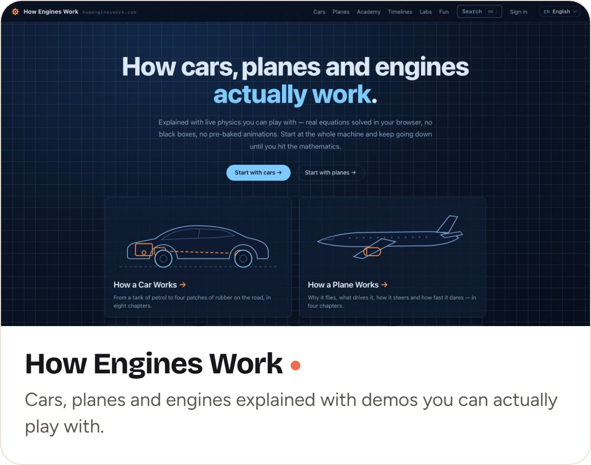
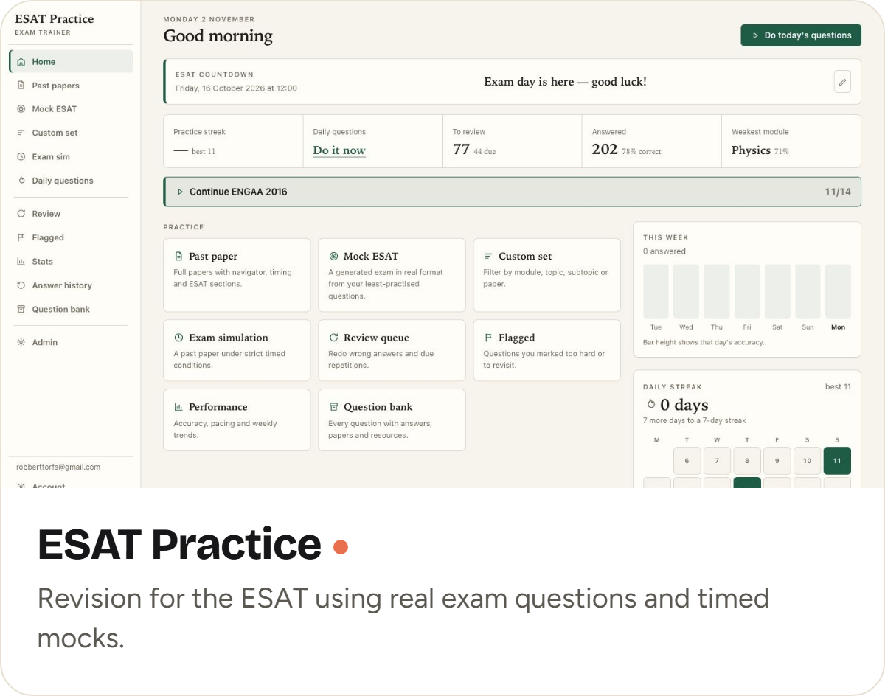
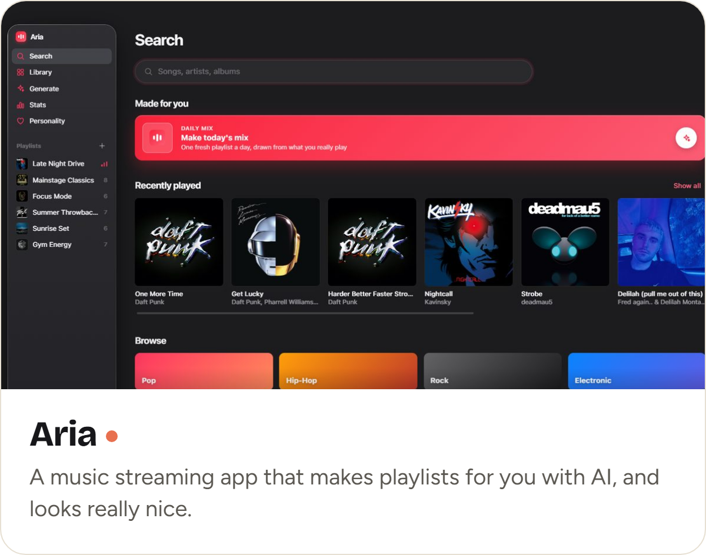

<picture><source media="(prefers-color-scheme: dark)" srcset="images/header-dark.png"></picture>

I'm a student developer. I'm Belgian, but I grew up in Dubai, and when I'm not building something I'm probably on a tennis court or playing football with my friends.

Most of my projects start with "wait, could I make that?" and then Claude and I find out. Some days that's a whole game. Some days it's something tiny that's been annoying me, like getting the little screen on my headset's base station to show what song is playing. I make something new pretty much every day, mostly just for fun.

 

### Some things I've made that people actually use

  <a href="https://nichenaut.app"><picture><source media="(prefers-color-scheme: dark)" srcset="images/card-nichenaut-dark.png"></picture></a>
  <a href="https://www.howengineswork.com"><picture><source media="(prefers-color-scheme: dark)" srcset="images/card-how-engines-work-dark.png"></picture></a>

  <picture><source media="(prefers-color-scheme: dark)" srcset="images/card-esat-practice-dark.png"></picture>
  <picture><source media="(prefers-color-scheme: dark)" srcset="images/card-aria-dark.png"></picture>

You might notice my repos look a bit empty. That's because nearly everything is private, not because I've been asleep. I promise.

My portfolio is still being built (a developer with no website, I know). Until then, say hi by [email](mailto:robberttorfs@gmail.com) or on [LinkedIn](https://www.linkedin.com/in/robbert-torfs-85a4a9376/).
