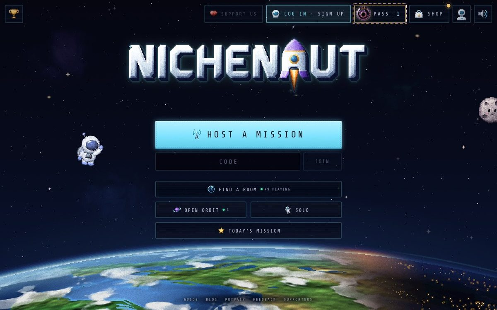
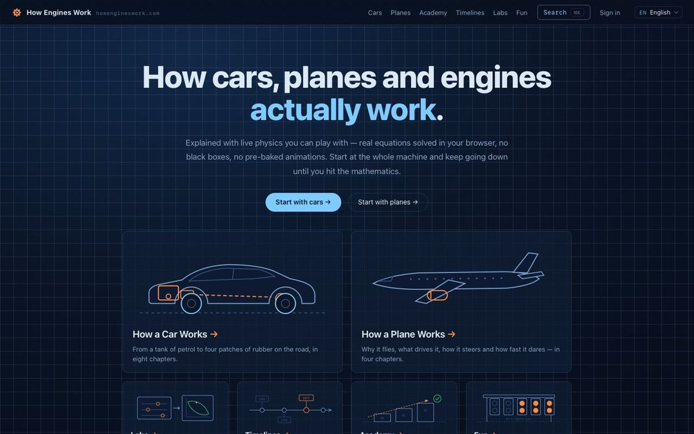
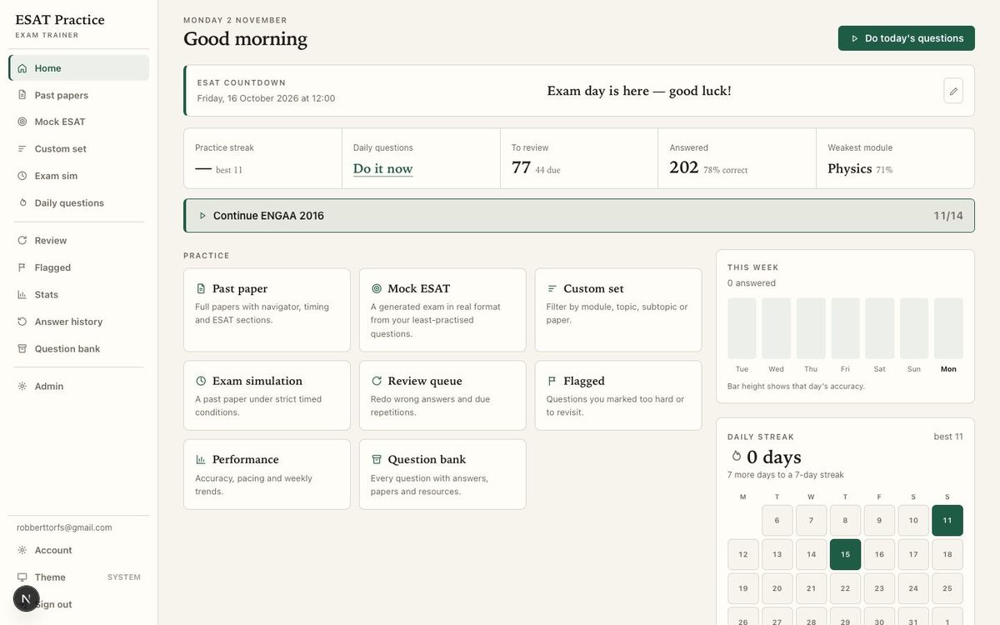
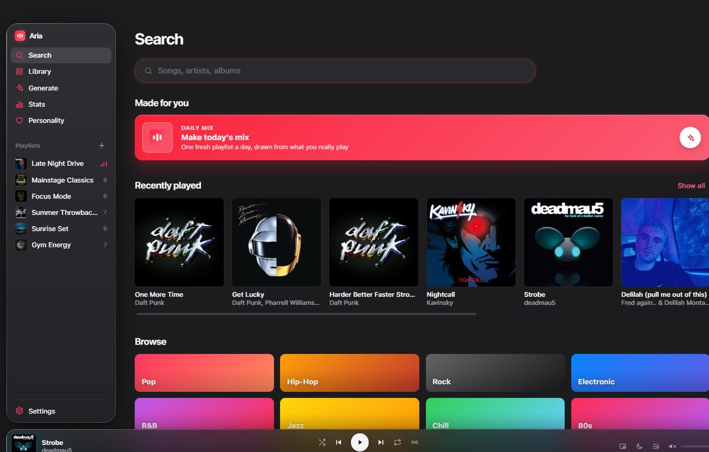

## Hi, I'm Robbert (yes, two b's)

I'm a student developer. I'm Belgian, but I grew up in Dubai, and when I'm not building something I'm probably on a tennis court or playing football with my friends.

Most of my projects start with "wait, could I make that?" and then Claude and I find out. Some days that's a whole game. Some days it's something tiny that's been annoying me, like getting the little screen on my headset's base station to show what song is playing. I make something new pretty much every day, mostly just for fun.

 

### Things I've built that real people use

<table>
  <tr>
    <td width="50%" valign="top">
      
      <h3><a href="https://nichenaut.app">Nichenaut</a></h3>
      A party game where the weirder your answer, the further you fly into space.
        
      <b>21,000+ players</b> in its first month.
    </td>
    <td width="50%" valign="top">
      
      <h3><a href="https://www.howengineswork.com">How Engines Work</a></h3>
      Cars, planes and engines explained with demos you can actually play with.
        
      <b>3,855 visitors</b> from 127 countries.
    </td>
  </tr>
</table>

<table>
  <tr>
    <td width="50%" valign="top">
      
      <h3>ESAT Practice</h3>
      Revision for the ESAT using real exam questions and timed mocks.
        
      <b>3,233 questions</b> answered by me and my friends.
    </td>
    <td width="50%" valign="top">
      
      <h3>Aria</h3>
      A music streaming app that makes playlists for you with AI, does all the normal stuff too, and looks really nice.
        
      <b>Used every day</b> since August.
    </td>
  </tr>
</table>

You might notice my repos look a bit empty. That's because nearly everything is private, not because I've been asleep. I promise.

My portfolio is still being built (a developer with no website, I know). Until then, say hi by [email](mailto:robberttorfs@gmail.com) or on [LinkedIn](https://www.linkedin.com/in/robbert-torfs-85a4a9376/).
